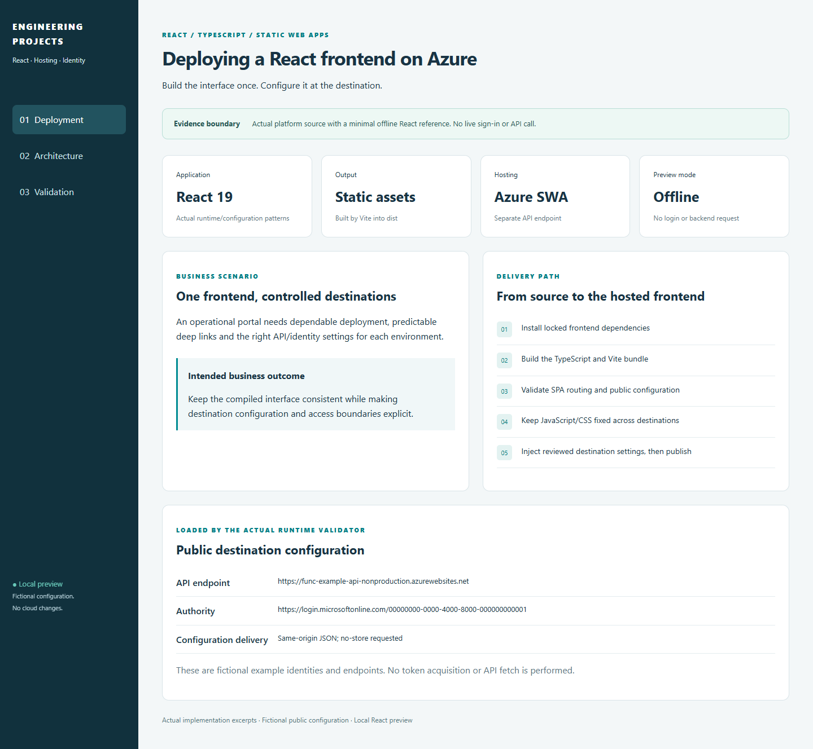
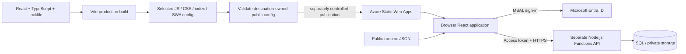
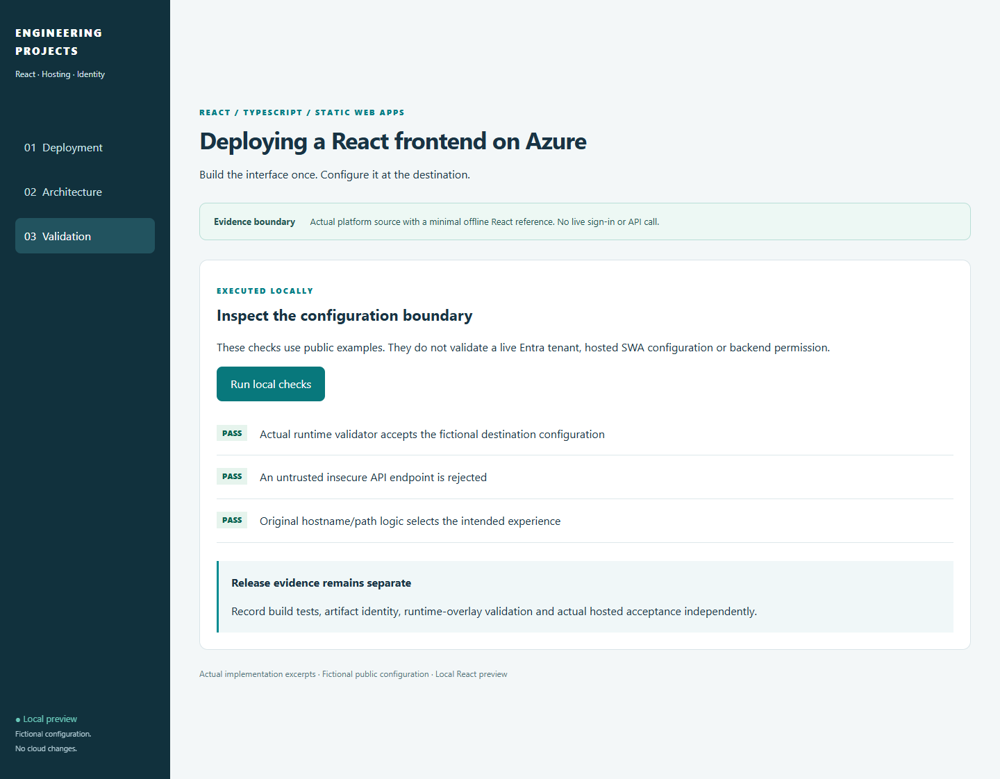

# Deploying a React Frontend with Azure Static Web Apps

**Build the website once, then give each environment its own connection settings.**

[The problem](#the-business-problem) · [The solution](#the-solution) · [What was built](#what-was-built) · [Proof it works](#proof-it-works) · [Commands](docs/COMMANDS.md)



## The Business Problem

The platform needs browser pages for staff and applicants, plus a protected server behind them. A release can upload successfully but still point at the wrong server, fail when someone refreshes a page, or mishandle sign-in. Rebuilding the website for each environment can also introduce differences.

## The Solution

Build the React website with Vite and host its files in Azure Static Web Apps. Load each environment’s public server and Microsoft sign-in settings before the application starts. Check page routing, security settings and useful error messages while keeping server permissions separate.

**Business outcome:** Keep the tested website files consistent between environments and make connection or sign-in problems easier to understand.

### Actual platform implementation

The project includes actual runtime-configuration validation/loading, MSAL configuration, API response/error handling, hostname/path experience selection, SWA routing/security configuration, runtime-config writer and Static Web Apps Terraform. Identifying domains and tenant/client IDs are replaced consistently with examples.

The running React shell is a new minimal public reference. It does not copy employee/applicant screens or business records. Its default preview validates public example settings without initializing MSAL or contacting an API. Two small browser-validator hardenings are recorded separately from the extracted source. [Source map](docs/SOURCE-MAP.md).

The platform's production SWA root selects the Free SKU and keeps existing custom-domain bindings/lifecycle under its environment root. The selected publisher uploads website files already built and tested with skip_app_build=true and leaves api_location empty because the business API is separately hosted. This repository performs no hosted publication. [Deployment process](docs/DEPLOYMENT.md).

## Architecture



Static Web Apps hosts the frontend; it is not the same service as Blob static-website hosting. Vite's development/preview server is not the complete SWA routing, header, domain or authentication platform.

## What Was Built

| Component | Purpose | Implementation |
| --- | --- | --- |
| Actual browser runtime loader | Validate public destination fields before the application initializes | [Source](frontend/src/lib/runtimeConfig.ts) |
| Actual MSAL configuration | Destination client/authority, origin-based redirects and sessionStorage | [Source](frontend/src/auth/msalConfig.ts) |
| Actual API response handling | Preserve useful validation details and distinguish session/access/conflict/unavailable errors | [Source](frontend/src/lib/apiClient.ts) |
| Actual hostname/path selection | Distinguish staff, application, Stage 2 and handoff entry points | [Source](frontend/src/lib/frontendExperience.ts) |
| Actual SWA config | SPA fallback, asset/config exclusions, security and cache headers | [Config](frontend/public/staticwebapp.config.json) |
| Actual runtime writer/tests | Validate destination settings and artifact-option compatibility | [Source](reference/web_runtime_config.py) |
| Actual SWA infrastructure | Static site, Free SKU selection and explicit optional custom domains | [Terraform](infra/) |
| Public React shell and staging helper | Inspect deployment boundaries and preserve bundle bytes across destination overlays | [UI](frontend/src/App.tsx) · [Staging](scripts/prepare_site.py) |

## Proof It Works

### 1. Compile and test the frontend

```bash
npm ci --prefix frontend --ignore-scripts --no-audit --no-fund
npm test --prefix frontend
npm run build --prefix frontend
```

**Look for:** TypeScript/Vite build success, original API-error and hostname/path scripts, and five new browser runtime/config checks. The React application renders from built assets; no real sign-in is required.

### 2. Keep bundle bytes while changing destination settings

```bash
python -B -m unittest discover -s reference -v
python -B -m unittest discover -s tests -v
python -B scripts/prepare_site.py --config config/nonproduction.example.json --output .release/nonproduction
python -B scripts/prepare_site.py --config config/production.example.json --output .release/production
```

**Look for:** the same bundle manifest hash and different runtime-config hashes. The helper refuses overlapping/existing output, invalid fields or a destination API not permitted by the reviewed CSP. It copies locally and uploads nothing.

### 3. Validate infrastructure without creating it

```bash
terraform -chdir=infra init -backend=false -input=false
terraform -chdir=infra validate
terraform -chdir=infra test
```

**Look for:** two tests using simulated cloud responses verify Free SKU, default-Off custom-domain activation and explicit domain/delegation inputs. No Azure resource or DNS change occurs.

### 4. Visible browser evidence



Desktop/mobile, tab navigation, direct deep-link refresh, invalid-config feedback and reload recovery were checked with zero external requests. These images show local React behavior, not a cloud deployment or hosted-header acceptance. [Dated validation](docs/VALIDATION.md).

## Run It Locally

Use Node 22 and Python 3.12 for the reference checks:

```bash
npm ci --prefix frontend --ignore-scripts --no-audit --no-fund
npm test --prefix frontend
npm run build --prefix frontend
npm run preview --prefix frontend -- --port 4173
```

Open [the local React preview](http://localhost:4173). Use localhost, not a different insecure host: the actual validator permits that local development-origin form. PowerShell can use npm.cmd. Ctrl+C stops Vite.

For development, run `npm run dev --prefix frontend` and use the printed localhost URL. The default example config is public/fictional. The optional MSAL provider shell is included for reviewed real integration, but the preview initializes neither sign-in nor backend access. [Commands and prerequisites](docs/COMMANDS.md).

## Deployment Process

1. Build/test the selected lockfile and React source once.
2. Retain the compiled bundle and its source/artifact evidence.
3. Validate destination-owned public API/Entra settings and the CSP/configuration contract.
4. Stage the environment-specific settings file while preserving compiled JS/CSS and reviewed static files.
5. In the real publisher, obtain the authorized SWA deployment token, mask it and upload prebuilt files with build skipped; do not copy credentials into the frontend.
6. Verify actual hosted navigation, headers, config cache behavior and authorized sign-in/API access separately. Preserve API workers/switches; a web-only publication does not activate them.

Compiled assets can be identical across environments while the destination JSON differs. That does not mean every final site byte or ZIP is identical: track the bundle and overlay independently. [Build and promotion detail](docs/DEPLOYMENT.md).

## Security Practices

- Browser code, Vite variables and runtime JSON are public. Never place API secrets, database credentials or a SWA deployment token in them.
- MSAL obtains an access token; the backend validates it and applies current role/record checks. Client routing and button visibility are not authorization.
- SWA deployment tokens, browser access tokens and Azure deployment identities have different roles.
- CORS and CSP control different browser behaviors. Neither grants backend record access.
- A hostname called private_portal describes a staff entry point, not a private network or confidential JavaScript bundle.
- Same-origin settings read when the application starts is fetched without caching; hosted cache/header behavior still needs independent verification.

## Scaling and Tradeoffs

Static assets scale differently from API/database traffic. Keep code splitting, cache policy, payload size, Entra flow and backend limits distinct. Destination configuration improves promotion consistency but adds a required required startup step. [Costs, strengths and tradeoffs](docs/SCALING.md).

## Project Guides

| Guide | Purpose |
| --- | --- |
| [Architecture](docs/ARCHITECTURE.md) | Frontend/API/identity boundaries |
| [Build and deployment](docs/DEPLOYMENT.md) | Prebuilt upload, environment-specific settings file and credential separation |
| [Runtime and authentication](docs/RUNTIME-AND-AUTH.md) | Public config, load order and optional MSAL integration |
| [Routing and headers](docs/ROUTING-AND-HEADERS.md) | SPA fallback, exclusions, CSP and cache settings |
| [Commands](docs/COMMANDS.md) | Local build/tests and expected results |
| [Source map](docs/SOURCE-MAP.md) | Where the code came from and what changed for this example |
| [Troubleshooting](docs/OPERATIONS.md) | Configuration, sign-in, fetch, CORS and deep-link failures |
| [Terraform](infra/README.md) | Static hosting and optional domain resources |
| [Validation](docs/VALIDATION.md) | Local results versus untested testing in the hosted environment |
| [Scaling](docs/SCALING.md) | Asset delivery, dependencies and costs |

## Cost and Cleanup

The project performs no Azure query/publication or domain activation. Local checks consume no hosted Actions minutes; the workflow is manual-only and has no cloud credentials or uploads. The source Free SKU does not make APIs, storage, DNS purchases or monitoring universally free. Real infrastructure/domain commissioning remains separate from this portfolio.
