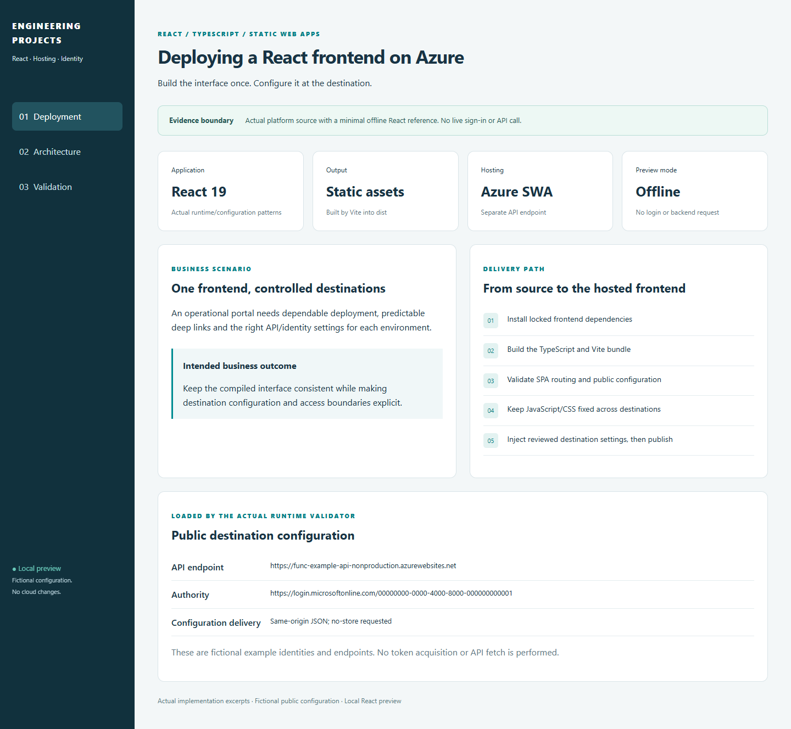
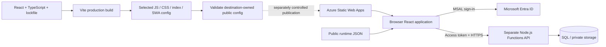
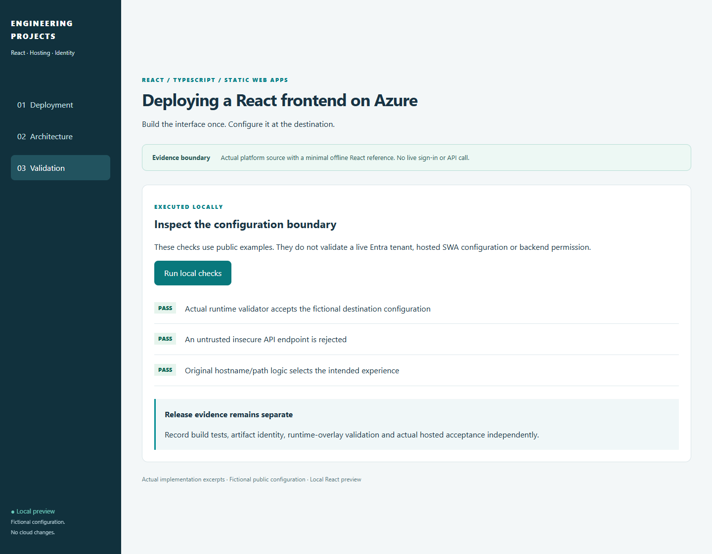

# Deploying a React Frontend with Azure Static Web Apps

**Build the website once, then give each environment its own connection settings.**

[The problem](#the-business-problem) · [The solution](#the-solution) · [What was built](#what-was-built) · [Proof it works](#proof-it-works) · [Commands](docs/COMMANDS.md) · [Step by step](#step-by-step)



## The Business Problem

Applicants need a dependable application form, and staff need browser pages for onboarding, employee records and daily operations. These users experience the website as one service, even though its pages, Microsoft sign-in and backend API have separate settings and deployment lifecycles.

An uploaded website can still open against the wrong backend, fail on a bookmarked page or leave a user stuck after sign-in. Rebuilding the frontend separately for each environment can introduce differences from the version already tested. A technical error with little explanation makes it difficult for users to know whether their work was saved or the service is unavailable.

The business need was a repeatable frontend release with the correct environment connections, reliable page navigation and clear failure messages, while protected decisions remain enforced by the server.

## The Solution

Build the React website with Vite and host its files in Azure Static Web Apps. Load each environment’s public server and Microsoft sign-in settings before the application starts. Check page routing, security settings and useful error messages while keeping server permissions separate.

**Business outcome:** Keep the tested website files consistent between environments and make connection or sign-in problems easier to understand.

### Actual platform implementation

The project includes actual runtime-configuration validation/loading, MSAL configuration, API response/error handling, hostname/path experience selection, SWA routing/security configuration, runtime-config writer and Static Web Apps Terraform. Identifying domains and tenant/client IDs are replaced consistently with examples.

The running React shell is a new minimal public reference. It does not copy employee/applicant screens or business records. Its default preview validates public example settings without initializing MSAL or contacting an API. Two small browser-validator hardenings are recorded separately from the extracted source. [Source map](docs/SOURCE-MAP.md).

The platform's production SWA root selects the Free SKU and keeps existing custom-domain bindings/lifecycle under its environment root. The selected publisher uploads website files already built and tested with skip_app_build=true and leaves api_location empty because the business API is separately hosted. This repository performs no hosted publication. [Deployment process](docs/DEPLOYMENT.md).

## Tools Used and What They Do

| Tool or service | What it does | Where it fits |
| --- | --- | --- |
| React and TypeScript | Build the website screens and their typed client code. | Actual frontend stack; the included shell is deliberately smaller. |
| Vite and npm | Build website assets from the recorded dependencies. | Build-time tools; generated assets are different from destination settings. |
| MSAL and Microsoft Entra ID | Initialize Microsoft sign-in and obtain the intended API access token. | Actual identity integration; server-side authorization remains separate. |
| Azure Static Web Apps | Host the compiled frontend and its routing/header configuration. | Actual hosting service; static assets do not contain private business records. |
| GitHub Actions | Build and publish the selected frontend release in the platform. | Public reference validation is manual-only and does not deploy Azure resources. |
| Python and PowerShell | Inspect packaging/configuration and support operating checks. | Reference and operating utilities, not browser application runtimes. |

The example website does not reproduce every production screen, login path or backend operation. Existing validation records distinguish built assets, hosted behavior and local checks.

## Step by Step

Your own React page built locally and deployed to a new Azure Static Web App from your own GitHub repository.

[Open the standalone build guide](docs/BUILD-YOUR-OWN.md) or follow the same complete instructions below.

Start with a new folder, your own files and your own accounts. The numbered steps below describe the build; no portfolio repository checkout is required. The existing implementation/evidence elsewhere in this repository is a separate reference, not a claim that your new build has already passed.

### Prerequisites

A Node version supported by your chosen Vite release; npm; Git; your own GitHub and Azure accounts; permission to create a Static Web App and its deployment workflow.

Use Bash on Linux/macOS/WSL for Bash blocks and PowerShell for PowerShell blocks. Select the tool versions supported by the official sources below, record the versions you actually install and retain generated dependency locks. Cloud resources, scanner downloads, logs and external AI calls can create costs; review the stated scope before enabling them.

### Create your project folder

Choose a new folder name. These first commands create a blank project; an optional `git init` gives it its own history. Create parent directories in your editor when a later step introduces a nested file.

```bash
mkdir my-azure-react-static-web-apps
cd my-azure-react-static-web-apps
git init
```

Create `.gitignore` before saving credentials or build outputs:

```gitignore
.venv/
node_modules/
.env
.env.*
local.settings.json
credentials.json
token.json
*.pem
*.key
*.tfstate*
*.tfplan
.terraform/
private*/
captures/
backups/
batch.json
reports/
out/
app-config.local.yaml
```

The source/file snippets are a starting implementation you type or paste into the named files. Replace `YOUR_*`, names, regions and addresses only with values from your own lab; do not place real client/employee records in a test project. Keep your terminal in this project root unless a step explicitly changes directory.

Before a first commit, set your own repository-local author with `git config user.name "YOUR_NAME"` and `git config user.email "YOUR_PUBLIC_COMMIT_EMAIL"`. Review `git status --short` and the staged diff before publishing; ignored local files are not a substitute for reviewing what you upload.

### Step 1 — Create a new React app

**Where:** A parent folder on your workstation.

Use Vite to scaffold a new app called my-portal, then install its dependencies. Record the resolved tool versions and retain package-lock.json rather than relying on an unrecorded future generator version.

```bash
npm create vite@latest my-portal -- --template react
cd my-portal
npm install
```

**Check before continuing:** You have a new app with its own source, package.json and dependency lock.

### Step 2 — Write your own page

**Where:** my-portal/src/App.jsx.

Replace the example component with the code below. Start with harmless local content so a deployment or screenshot cannot disclose employee information.

Create **`src/App.jsx`** with the following contents:

```jsx
export default function App() {
  return <main style={{maxWidth: 760, margin: '3rem auto', padding: '1rem'}}>
    <h1>My operations portal</h1>
    <p>A small React site deployed through my own release pipeline.</p>
    <section><h2>Service status</h2><p>This first build has no live backend.</p></section>
  </main>;
}
```

**Check before continuing:** The page displays your own service name and purpose.

### Step 3 — Test the production build locally

**Where:** Your app folder.

Run the build and preview, then open the URL printed by Vite. Check the browser console and the page on a narrow screen before publishing.

```bash
npm run build
npm run preview
```

**Check before continuing:** dist exists and your production bundle loads without an assumed backend.

### Step 4 — Create your own remote repository

**Where:** Your app folder and GitHub.

Initialize Git, ignore node_modules and local secrets, commit your source and lockfile, and create an empty repository in your own account. Add that repository as origin and push your branch; no existing portfolio checkout is involved.

```bash
git init
git add .
git commit -m "Create my React portal"
# Create an empty repository in your account, then:
git branch -M main
git remote add origin https://github.com/YOUR_ACCOUNT/YOUR_NEW_REPOSITORY.git
git push -u origin main
```

**Check before continuing:** Your own repository contains the app you just wrote.

### Step 5 — Configure Static Web Apps

**Where:** Azure Portal → Static Web Apps → Create.

Choose your own repository and branch, React preset, app location /, output location dist and no API location for this frontend-only build. Review the plan and generated workflow; its deployment credential belongs in the generated GitHub secret, never in source.

**Check before continuing:** The generated workflow builds this app and publishes its dist output.

### Step 6 — Verify the hosted page and your update path

**Where:** Azure Portal deployment URL and GitHub Actions.

Wait for a successful deployment, open the hosted URL and confirm the page content. Change your own heading, commit it and verify a new successful deployment; then configure identity and backend calls as separate, tested additions.

**Check before continuing:** Your own source change reaches the intended hosted page.

### Step 7 — Record and clean up

**Where:** Your evidence folder and Azure Portal.

Capture the page, build settings and deployment run without tokens or private account details. Delete the dedicated Static Web App when finished and account for any separately created domains or backend resources.

**Check before continuing:** The build and publication steps can be followed by someone with their own accounts.

### Verification and your own screenshots

| Evidence | What to record | Your result |
| --- | --- | --- |
| New build | Your own files/resource settings and tool versions | Not yet recorded |
| Working path | The actual successful request, configuration or recovery result | Not yet recorded |
| Failure boundary | A meaningful denied, malformed, stale or failed case | Not yet recorded |
| Recovery / cleanup | What you restored or removed and what remains billed | Not yet recorded |

Capture your own architecture/configuration, one working result and one failure/recovery result. Keep tokens, credentials, personal records and private identifiers out of public screenshots. Existing portfolio images are references, not evidence that you performed these steps.

### Troubleshooting order

1. Confirm the named file, working directory and selected tool/interpreter.
2. Check the exact input and resource/account selected for the failing step.
3. Separate identity permission, network/DNS reachability and application validation.
4. Keep the actual error and reconcile an unknown write outcome before repeating it; do not widen access or repeat paid operations blindly.

The numbered steps describe a build procedure. Local syntax checks, an accepted API request, a completed hosted operation and a human verification are different evidence levels; fill in the verification table with what you actually observed.

### Official implementation references

- [learn.microsoft.com — getting-started](https://learn.microsoft.com/en-us/azure/static-web-apps/getting-started)
- [vite.dev — guide](https://vite.dev/guide/)

The walkthrough layout follows the prerequisites → creation/configuration → test → verification → troubleshooting → cleanup pattern of the [Splunk project reference](https://github.com/davidharris6/splunk-siem-log-analysis). Its Splunk-specific settings are not copied into unrelated projects.

<details>
<summary>Reference: how the existing platform implementation operates</summary>

A short walkthrough of the process, with technical instructions and evidence limits in the sections below.

1. **Build the website (React and Vite)** — Select the reviewed React source and build its website files. Test the page behavior and keep the resulting files for release.

2. **Set the destination details** — Provide the public server and Microsoft sign-in settings for the chosen environment. The website checks these settings before starting.

3. **Publish the prepared files (Static Web Apps)** — The platform release process uploads the tested files to Azure Static Web Apps. The business server remains separately hosted and checks its own permissions.

4. **Verify the user experience** — Check navigation, sign-in settings and useful connection error messages. The public demonstration uses example settings and does not publish a live website.

</details>

## Architecture



Static Web Apps hosts the frontend; it is not the same service as Blob static-website hosting. Vite's development/preview server is not the complete SWA routing, header, domain or authentication platform.

## What Was Built

| Component | Purpose | Implementation |
| --- | --- | --- |
| Actual browser runtime loader | Validate public destination fields before the application initializes | [Source](frontend/src/lib/runtimeConfig.ts) |
| Actual MSAL configuration | Destination client/authority, origin-based redirects and sessionStorage | [Source](frontend/src/auth/msalConfig.ts) |
| Actual API response handling | Preserve useful validation details and distinguish session/access/conflict/unavailable errors | [Source](frontend/src/lib/apiClient.ts) |
| Actual hostname/path selection | Distinguish staff, application, Stage 2 and handoff entry points | [Source](frontend/src/lib/frontendExperience.ts) |
| Actual SWA config | SPA fallback, asset/config exclusions, security and cache headers | [Config](frontend/public/staticwebapp.config.json) |
| Actual runtime writer/tests | Validate destination settings and artifact-option compatibility | [Source](reference/web_runtime_config.py) |
| Actual SWA infrastructure | Static site, Free SKU selection and explicit optional custom domains | [Terraform](infra/) |
| Public React shell and staging helper | Inspect deployment boundaries and preserve bundle bytes across destination overlays | [UI](frontend/src/App.tsx) · [Staging](scripts/prepare_site.py) |

## Proof It Works

### 1. Compile and test the frontend

```bash
npm ci --prefix frontend --ignore-scripts --no-audit --no-fund
npm test --prefix frontend
npm run build --prefix frontend
```

**Look for:** TypeScript/Vite build success, original API-error and hostname/path scripts, and five new browser runtime/config checks. The React application renders from built assets; no real sign-in is required.

### 2. Keep bundle bytes while changing destination settings

```bash
python -B -m unittest discover -s reference -v
python -B -m unittest discover -s tests -v
python -B scripts/prepare_site.py --config config/nonproduction.example.json --output .release/nonproduction
python -B scripts/prepare_site.py --config config/production.example.json --output .release/production
```

**Look for:** the same bundle manifest hash and different runtime-config hashes. The helper refuses overlapping/existing output, invalid fields or a destination API not permitted by the reviewed CSP. It copies locally and uploads nothing.

### 3. Validate infrastructure without creating it

```bash
terraform -chdir=infra init -backend=false -input=false
terraform -chdir=infra validate
terraform -chdir=infra test
```

**Look for:** two tests using simulated cloud responses verify Free SKU, default-Off custom-domain activation and explicit domain/delegation inputs. No Azure resource or DNS change occurs.

### 4. Visible browser evidence



Desktop/mobile, tab navigation, direct deep-link refresh, invalid-config feedback and reload recovery were checked with zero external requests. These images show local React behavior, not a cloud deployment or hosted-header acceptance. [Dated validation](docs/VALIDATION.md).

## Run It Locally

Use Node 22 and Python 3.12 for the reference checks:

```bash
npm ci --prefix frontend --ignore-scripts --no-audit --no-fund
npm test --prefix frontend
npm run build --prefix frontend
npm run preview --prefix frontend -- --port 4173
```

Open [the local React preview](http://localhost:4173). Use localhost, not a different insecure host: the actual validator permits that local development-origin form. PowerShell can use npm.cmd. Ctrl+C stops Vite.

For development, run `npm run dev --prefix frontend` and use the printed localhost URL. The default example config is public/fictional. The optional MSAL provider shell is included for reviewed real integration, but the preview initializes neither sign-in nor backend access. [Commands and prerequisites](docs/COMMANDS.md).

## Deployment Process

1. Build/test the selected lockfile and React source once.
2. Retain the compiled bundle and its source/artifact evidence.
3. Validate destination-owned public API/Entra settings and the CSP/configuration contract.
4. Stage the environment-specific settings file while preserving compiled JS/CSS and reviewed static files.
5. In the real publisher, obtain the authorized SWA deployment token, mask it and upload prebuilt files with build skipped; do not copy credentials into the frontend.
6. Verify actual hosted navigation, headers, config cache behavior and authorized sign-in/API access separately. Preserve API workers/switches; a web-only publication does not activate them.

Compiled assets can be identical across environments while the destination JSON differs. That does not mean every final site byte or ZIP is identical: track the bundle and overlay independently. [Build and promotion detail](docs/DEPLOYMENT.md).

## Security Practices

- Browser code, Vite variables and runtime JSON are public. Never place API secrets, database credentials or a SWA deployment token in them.
- MSAL obtains an access token; the backend validates it and applies current role/record checks. Client routing and button visibility are not authorization.
- SWA deployment tokens, browser access tokens and Azure deployment identities have different roles.
- CORS and CSP control different browser behaviors. Neither grants backend record access.
- A hostname called private_portal describes a staff entry point, not a private network or confidential JavaScript bundle.
- Same-origin settings read when the application starts is fetched without caching; hosted cache/header behavior still needs independent verification.

## Scaling and Tradeoffs

Static assets scale differently from API/database traffic. Keep code splitting, cache policy, payload size, Entra flow and backend limits distinct. Destination configuration improves promotion consistency but adds a required required startup step. [Costs, strengths and tradeoffs](docs/SCALING.md).

## Troubleshooting Lessons

A frontend expected routes absent from its deployed backend, then displayed a misleading JSON parsing error. Response handling and release compatibility had to be checked separately. [Read the incident, evidence and verification](docs/LESSONS-LEARNED.md).

## Project Guides

| Guide | Purpose |
| --- | --- |
| [Architecture](docs/ARCHITECTURE.md) | Frontend/API/identity boundaries |
| [Build and deployment](docs/DEPLOYMENT.md) | Prebuilt upload, environment-specific settings file and credential separation |
| [Runtime and authentication](docs/RUNTIME-AND-AUTH.md) | Public config, load order and optional MSAL integration |
| [Routing and headers](docs/ROUTING-AND-HEADERS.md) | SPA fallback, exclusions, CSP and cache settings |
| [Commands](docs/COMMANDS.md) | Local build/tests and expected results |
| [Source map](docs/SOURCE-MAP.md) | Where the code came from and what changed for this example |
| [Troubleshooting](docs/OPERATIONS.md) | Configuration, sign-in, fetch, CORS and deep-link failures |
| [Terraform](infra/README.md) | Static hosting and optional domain resources |
| [Validation](docs/VALIDATION.md) | Local results versus untested testing in the hosted environment |
| [Scaling](docs/SCALING.md) | Asset delivery, dependencies and costs |

## Cost and Cleanup

The project performs no Azure query/publication or domain activation. Local checks consume no hosted Actions minutes; the workflow is manual-only and has no cloud credentials or uploads. The source Free SKU does not make APIs, storage, DNS purchases or monitoring universally free. Real infrastructure/domain commissioning remains separate from this portfolio.
